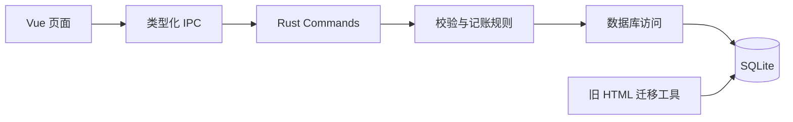

# 架构与数据约定

ClearLedger（清账）是基于 Tauri 2 的本地桌面账单应用，采用模块化单体结构。

## 当前实现

- Vue Router 使用 hash 路由；Pinia 管理应用状态；Naive UI 提供基础组件。
- 收支总览与月度支出分工：总览展示年度支出指标、月度净支出柱状图与分类支出；月度支出页展示单月每日走势、每日明细表，并通过 `?month=` 深链保持可分享的月份状态。
- 图表为轻量自绘 SVG/CSS，不引入图表库；配色以 CSS 变量区分浅色与深色主题，并已通过色觉障碍可辨性校验。
- Rust 同步数据库操作在阻塞工作线程执行；互斥单连接串行访问 SQLite。
- SQLite schema v3 包含账本、设置、交易、审计、幂等请求、迁移记录、退款关系与金额口径校验。
- 数据库启用 WAL、外键、FULL 同步和超时等待；升级已有数据库前生成一致性快照。
- 更新使用 revision 防止覆盖并发修改；相同 request_id 与相同输入重试返回原结果。
- 业务修改、审计与请求记录在同一事务提交。

## 金额与统计

金额以 i64 整数分保存，通过 IPC 使用字符串传递，前端使用 BigInt，避免浮点舍入。金额输入要求正值且最多两位小数。首版仅支持人民币。

正式汇总只计算有效且已确认的交易。退款按归属日冲减支出；本人转账、本金还款、借贷本金不计收入或消费。期间结余不是银行余额或净资产。手工账本没有覆盖证明，无记录不能等同于完整账单下的零消费。

## 数据位置兼容

应用名称为清账 / ClearLedger。当前保留初始版本的 Tauri identifier `com.jason.personalledger`，避免名称升级导致已有用户的数据目录改变。操作系统应用数据目录由 Tauri 解析，数据库名为 ledger.sqlite3；编译产物内部名称暂保留 ledger-desktop。

## 旧 HTML 迁移

scripts/import_legacy_html.py 只解析 ledger-data JSON 数据块，不执行导入 HTML 的脚本。它在写入前备份，保留压缩 HTML、原始流水、分组、候选和审计，并验证记录守恒。零金额组保留在证据表，不伪造正金额交易。

迁移工具使用 legacy_* 扩展表，保持 schema v2 可被已有程序读取。真实导入来源记录在 legacy_transaction_map.origin=legacy_html；transactions.origin 受旧 v2 CHECK 约束保留兼容值 manual，该值不代表人工确认。确认状态以 review_status 为准。

HTML 不包含浏览器 localStorage 中的修正。当前不支持迁移修正备份，导入数据统一待核实；旧初步资格独立保存。相同 HTML 重试不覆盖后续人工编辑，变化文件中出现原始 ID 冲突则回滚。

## 退款核对

Rust 领域层进行渠道与类型限定的强标识关联、独立事件识别和毛额/净额等式验证；数据库层事务保存关系与审计，统计层按关系完整性和版本检查暂停未通过的组。校验不自动修改金额或确认状态。待核实页提供扫描、分页、证据、驳回和撤销入口，详见 [退款规则](REFUNDS.md)。

schema v3 通过迁移前快照和事务升级，旧 v2 程序需要重新编译后使用。

## 后续演进

规范分类和账户引用、来源证据 UI、导入适配器、专用写入队列、独立读连接、迁移校验和、初步/正式口径切换及完整备份恢复尚待实现。迁移前快照不等于具备完整备份恢复功能。数据库和源文件目前不加密。
